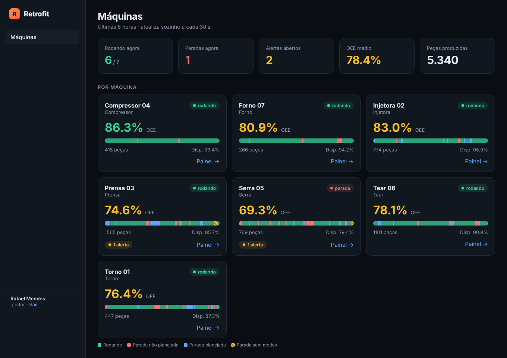
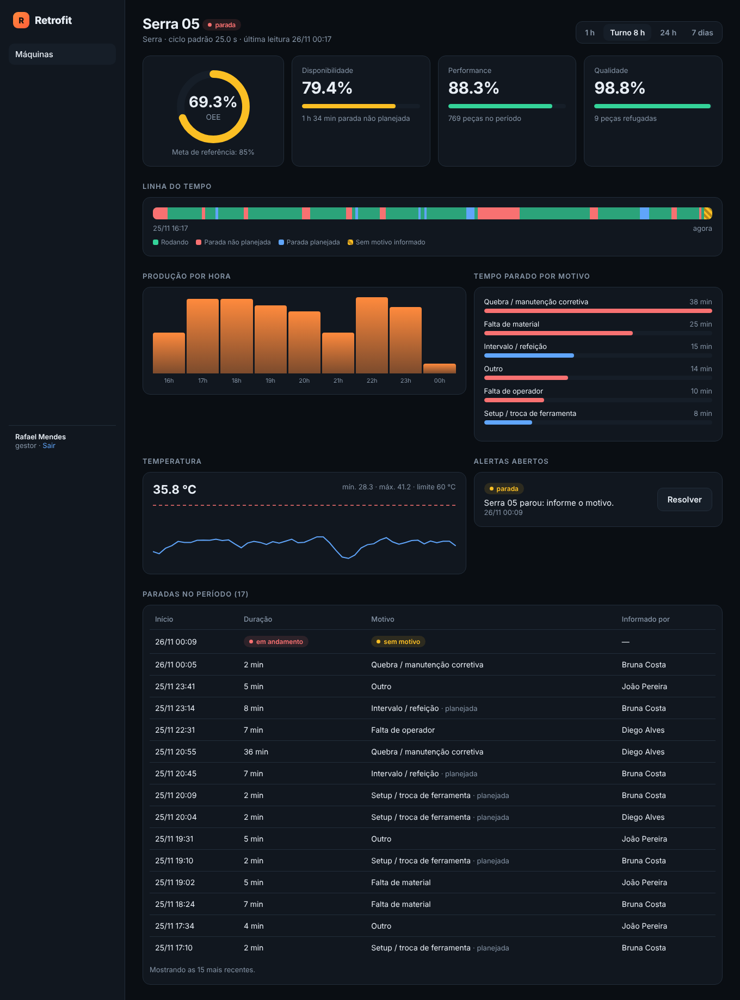
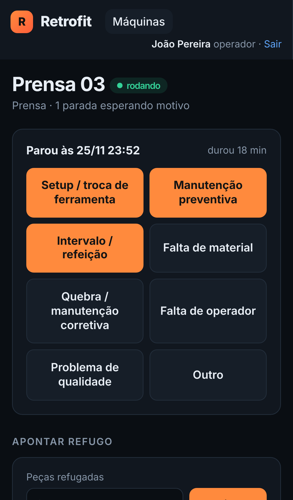

# Retrofit

Plataforma web do **Retrofit** (Retro Automação). A peça Retrofit vai instalada em máquinas industriais antigas e envia as leituras para esta plataforma.

- O **operador** informa o motivo de cada parada pelo celular, lendo o QR code da máquina, ou pelo PC.
- O **gestor** acompanha a disponibilidade, a performance, a qualidade e o OEE de cada máquina.

Trabalho final de TAND (Tópicos Avançados em Negócios Digitais), Univille, 2026-2.



| Painel do gestor | Tela do operador (celular) |
| --- | --- |
|  |  |

## Demonstração rápida (dados fictícios)

Você precisa do Python 3.10 ou mais novo.

```bash
pip install -r requirements.txt
python demo.py
```

No Windows, use `py` no lugar de `python`.

Depois abra **http://localhost:5000** e escolha um dos botões "entrar com um clique". O `demo.py` faz três coisas:

1. Cria a fábrica de demonstração com 5 usuários e as 7 máquinas do protótipo 3D: torno, injetora, prensa, compressor, serra, tear e forno.
2. Gera 24 horas de histórico fictício: leituras, paradas com motivo, refugo e alertas.
3. Continua gerando leituras a cada 10 segundos enquanto o sistema estiver aberto, como se as peças estivessem instaladas.

Todos os dados da demonstração são fictícios. Para parar, aperte `Ctrl + C`.

## Rodar sem dados de demonstração

```bash
python app.py init --demo     # banco só com os usuários e as máquinas, e mostra o token de cada máquina
python app.py                 # abre em http://localhost:5000
```

Usuários de demonstração, todos com a senha `retrofit123`:

| E-mail | Perfil | O que vê |
| --- | --- | --- |
| admin@demo.com | Administrador | Cadastro de usuários e máquinas, além de tudo o que o gestor vê |
| gestor@demo.com | Gestor | Visão geral das máquinas, painel com OEE e alertas |
| operador@demo.com | Operador | Tela da máquina: motivo da parada e refugo |

### Simular a peça

Sem a peça física, o simulador envia leituras para a API como a peça enviaria. Use o token mostrado no `init`:

```bash
python simulador.py --token <TOKEN> --historico 8   # gera 8 horas de leituras de uma vez
python simulador.py --token <TOKEN>                 # tempo real: uma leitura a cada 10 s
```

## Testes

```bash
python -m pytest -v
```

São 15 casos de teste (CT01 a CT15). Eles cobrem o login, o controle de acesso, os cadastros, a API da peça, as paradas, o refugo, os alertas e o cálculo do OEE. O resultado da última execução está em [`docs/resultado_testes.txt`](docs/resultado_testes.txt).

## API da peça

```
POST /api/leituras
X-Token: <token da máquina>
Content-Type: application/json

{"estado": "rodando", "pecas": 2, "temperatura": 41.5, "corrente": 9.8}
```

| Resposta | Quando |
| --- | --- |
| `201` | Leitura gravada |
| `401` | Token inválido ou máquina inativa |
| `400` | Dado inválido |

O campo `data_hora` (`AAAA-MM-DD HH:MM:SS`) é opcional. Ele serve para enviar leituras atrasadas.

## Estrutura

```
app.py                  rotas, telas, cálculo do OEE e API da peça
schema.sql              banco SQLite (usado pelo sistema)
schema_postgres.sql     o mesmo banco para PostgreSQL
templates/              telas em HTML (Jinja2)
demo.py                 demonstração com 7 máquinas e dados fictícios, ao vivo
simulador.py            simulador da peça Retrofit (envia pela API)
tests/test_app.py       casos de teste
docs/                   diagramas, prints das telas e protótipo navegável
```

## Documentação

- **Documento da entrega técnica (PDF):** [`docs/Retrofit_Entrega_Tecnica.pdf`](docs/Retrofit_Entrega_Tecnica.pdf)
- Diagrama de casos de uso: [`docs/diagramas/casos_uso.png`](docs/diagramas/casos_uso.png)
- MER: [`docs/diagramas/mer.png`](docs/diagramas/mer.png)
- Diagrama de tabelas: [`docs/diagramas/tabelas.png`](docs/diagramas/tabelas.png)
- Prints das telas: [`docs/telas/`](docs/telas/)
- Protótipo navegável: [`docs/prototipo-telas.html`](docs/prototipo-telas.html). Baixe o arquivo e abra no navegador.

Os requisitos, as regras de negócio, a descrição dos casos de uso e o dicionário de dados estão no documento da entrega técnica.

## Tecnologias

Python 3, Flask 3, SQLite 3, qrcode e pytest. Todas são livres e sem custo de licença.

## Equipe

| Integrante | Função |
| --- | --- |
| Leonardo Latzke | Product Owner |
| Renan Apolinario | Tech Leader |
| Gustavo Antonius | Back-end |
| Matheus de Araújo | Front-end |
| Yohann Pohl | DBA |
| Guilherme Costa | QA / Testes |
| Carlos Tomasi | Documentação |
